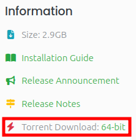
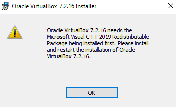
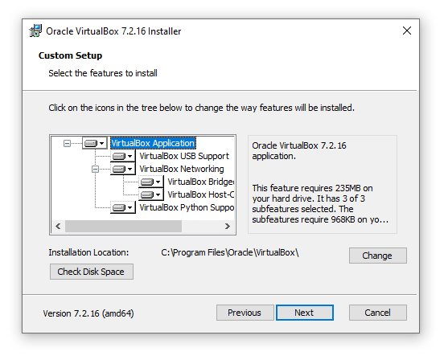
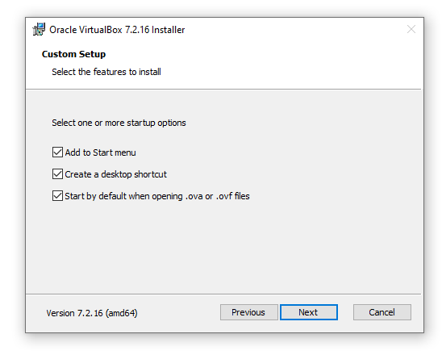
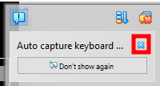
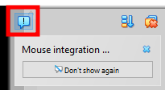
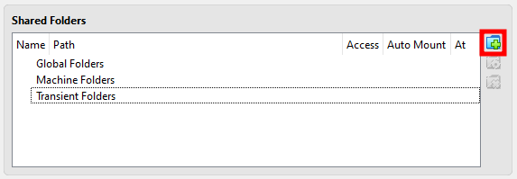

<!--
	settings.json:
	
	"markdown-pdf.displayHeaderFooter": false,
	"markdown-pdf.sanitize": "gfm-allow-style"
-->

<style>
	:not(pre):not(.hljs) > code
	{
		color: #000000;
		background-color: #D0D0D0;
	}
</style>

# Introduction to Linux - Pre-Workshop

This workshop assumes you're using a Windows laptop that can comfortably run virtual machines (you don't need this workshop if you already use Linux). We recommend that your laptop has 3 GB of free RAM and 32 GB of free disk space if you're going to attend. The workshop only covers Windows 10 instructions. Ask the host during the help desk session for guidance if using another OS like macOS.

Because the installation process can take a while based on your hardware, you must have a complete installation of Linux before attending the main workshop. This pre-workshop will cover that.

Download all the provided pre-workshop to your system so they're ready.

## Obtaining Linux

This workshop will use Linux Mint Cinnamon Edition.

To obtain the download options:
1. Visit: <https://www.linuxmint.com/download.php>
2. Find Cinnamon Edition and press "Download".

You will have the option to download it directly or via BitTorrent. BitTorrent may be the fastest way to download it due to taking advantage of leeching from multiple peers in parallel. Conversely, you're also sharing your copy for others to download (seeding) until you stop the torrent. Use the BitTorrent option if you're familiar with it.

* To download it directly, scroll down to "Download mirrors" and choose a mirror to download it from.<br>
  The Australian AARNet mirror should be the fastest due to being the closest.
* The BitTorrent option can be found here:<br>
  

## Linux Virtualisation

You'll need to prepare a virtual machine with an installation of Linux. VirtualBox is a user-friendly option that is recommended for those who are new to virtualisation. If you want to use a VMware or other solution instead, you may skip to [Creating Virtual Machine](#create-vm).

<div class="page" />

> ### Why Virtualisation?
> 
> Virtualisation allows a separate computer running its own OS to be 'simulated' within another computer, such as your laptop. The advantages of this are:
> * A separate machine for installing Linux on is not required.
> * More predictable/consistent (virtual) hardware, allowing OSes to support all the essential components without additional drivers. This eliminates the concern of not being able to download and install additional drivers due to a missing network driver, a common problem with some distros that may not even have a supported driver.
> * Easier to transfer data between the host and guest (another name for the OS on the virtual machine). By installing a driver for this purpose:
>   * The clipboard can be shared.
>   * Files can be dragged and dropped.
>   * A folder can be shared between the host and guest.

## Installing VirtualBox for Windows

1. Go to: <https://www.virtualbox.org/>
2. Press "Download" in the top right corner.
3. Under "VirtualBox Platform Packages", press "Windows hosts".
4. Once download completes, open the downloaded installer.
5. Press "Yes" in the User Account Control prompt.

### Dependencies

If you get this error, you'll need to download the Microsoft Visual C++ Redistributable Package:<br>


Skip to [VirtualBox Installer](#virtualbox-installer-windows) otherwise.

<div class="page" />

To install it:
1. Go to: <https://learn.microsoft.com/en-us/cpp/windows/latest-supported-vc-redist?view=msvc-170>
2. Go to the section "Latest supported redistributable version" and download the one that matches your system architecture, most likely X64.
3. Run the downloaded installer.
4. Check "I agree to the license terms and conditions" and press "Install".
5. Press "Yes" in the User Account Control prompt.
6. Once it's done, close the installer and re-run the VirtualBox installer.

### <span id="virtualbox-installer-windows">VirtualBox Installer</span>

1. Once in the installation wizard, press "Next".
2. Select "I accept the terms of the license agreement" and press "Next".
3. Press "Next" on this screen since it doesn't really matter in most cases:<br>
  
4. Press "Yes" on the "Network Disconnection" warning.
5. If asked about installing missing dependencies such as the Python Core package and win32api bindings, press "Yes".<br>
   These are not required for most VirtualBox users.
6. Feel free to deselect any option here if you'd like and press "Next":<br>
  
7. Press "Install".
8. Once it's done, press "Finish". It'll open VirtualBox unless unchecked.

## <span id="create-vm">Creating Virtual Machine</span>

1. Open VirtualBox. Use Basic Mode as the pre-workshop is written for it.
2. Press "New" in the top left and in the prompt that opens:
   * Choose a name for the virtual machine (VM) such as "Linux Workshop VM".
   * Press the dropdown arrow for "ISO Image", press "Other..." and select the downloaded ISO. This is what the VM will initially boot from.
   * Uncheck "Proceed with Unattended Installation" for an installation experience that more closely mimics real hardware.
3. Press "Next". The next prompt will ask for the VM's hardware requirements. Use the following:
   * At least 2560 MB (2.5 G) of Base Memory. This will use up to this much host system ram.
   * Number of CPUs to your system's physical core count.
     * This does not mean that half of the host's CPU will be used up just from running the VM.<br>
	 It'll only consume that much when something running inside the VM does.
     * Increasing CPU count above 1 improves responsiveness of the VM.
     * On a system with 2 cores and Hyper-Threading (Intel) or SMT (AMD), this means setting it to 2.
   * Disk Size of 25 GB. This will use up to this much host disk space.
   * Check "Use EFI", as modern systems are UEFI-based. This will make the experience more similar to real modern hardware.
4. Press Next and feel free to review the summary. Press Finish once satisfied to create the VM.

<div class="page" />

## Installing Linux

1. Select the VM and press "Start" in top left.
2. The VM will open, and it'll start capturing keystrokes when in focus, preventing keyboard shortcuts like `[Alt]`+`[Tab]` from working on the host OS.<br>
   * To stop capturing keystrokes, press the host key combo, which is `[Right Ctrl]` by default.
   * When refocusing on the VM window, it'll resume capturing keystrokes.
   * The notification on the right will explain all of this. Click on it to read it or press the close button in the top right of it to dismiss it:<br>
     
3. There is a chance that the VM's viewport is too tall for the window. Maximising it is recommended.<br>
   * If it's still too tall, use the scrollbar on the right of it.
4. The VM will have booted into the live image, which will present boot options. Leave the first option selected (select with `[Up]`/`[Down]`) and press `[Enter]`.
   * This menu is part of the bootloader, which is responsible for loading and starting the kernel of an OS.
   * This bootloader is called GRUB, a common choice for Linux distros.
5. Another notification, "Mouse integration", will pop up. To collapse the notification centre without dismissing notifications, press the button in the top left of it:<br>
   
6. The VM will boot into the live environment. Once booted, the guest resolution can be reduced if still too tall. See "Screen Resolution.pdf" for instructions on how to do this.
7. Run "Install Linux Mint". Choose a language and press "Continue".
8. The keyboard layouts "English (US)" and "English (Australia)" should be identical. Select one and press "Continue".
9. Installing multimedia codecs is recommended. Check it and press "Continue".<br>
   Note that on a real system, it may ask to configure Secure Boot.
10. The VM has nothing installed on its disk. Leave "Erase disk and install Linux Mint" selected and press "Install Now".<br>
    "Advanced features..." is out of scope, but is useful for custom partitioning.
11. It'll ask to confirm the changes before installing. There's only one disk in the VM so press "Continue".
12. Select your location. This will be used to determine your time zone. Press "Continue" once done.

13. The next screen is for setting up the user account and hostname.
    * For simplicity, set your username and password to `a`.
    * "Your name" is a display name separate from the actual login username.<br>
	   This can contain characters not allowed in the username such as capital letters and spaces.
    * Leave "Require my password to log in" as that's usually the case on a real system.
    * Leave "Encrypt my home folder" unchecked as encryption is out of scope.
14. The installation may take a while depending on your hardware. Once it's complete, press "Restart Now" as we'll be exploring the full installation instead.
15. The ISO file will have been auto-ejected, press `[Enter]` to continue restarting.

## Setting up Linux

The VM should will now have booted into the full installation of Linux Mint, prompting for your chosen password.
1. Enter your password.
2. The welcome dialogue opens on login by default to greet users who just installed Linux Mint. Close it for now as it'll be explored in the main workshop instead.
3. The Update Manager may open on it's own after a while. Close it for now as it'll also be explored in the main workshop instead.

### VirtualBox Guest Additions

VirtualBox Guest Additions can be installed to improve ease of use of the VM. It:
* Adjusts the guest (another name for the OS on the virtual machine) resolution to match the VM window.
* Syncs the clipboard between the host and guest, allowing for copying and pasting between them.<br>
  <!-- Even supports copying files via the clipboard. -->
  Note that, at least on Linux guests, copying files via the clipboard doesn't seem to work.
* Enables dragging and dropping files in and out of the guest.
* Enables sharing a host folder to the guest, adding another vector for files to be transferred between them.

To install it:
1. An disk image for installing it can be mounted by going to the menu bar > Devices > "Insert Guest Additions CD image...".
2. Linux Mint will detect the mounted image and prompt if you want to run the software on it. Press "Run".
3. A prompt to grant the installer super user (administrator) privileges. Enter your password to authenticate it.
4. The installer will say "Press Return to close this window..." once it's complete. Press Enter to close it (duh).

5. To allow the user to access shared folders:
   1. Open the terminal, either from the taskbar or pressing `[Ctrl]`+`[Alt]`+`[T]`.
   2. Enter the following command to add the user to the shared folders group:
      ```sh
      sudo usermod -aG vboxsf $USER
      ```
   3. Enter your password to authenticate the command.
6. Restart the VM so that all of the Guest Addition features are available.<br>
   This can be done from the terminal by simply running:
   ```sh
   reboot
   ```
7. Eject the Guest Additions disk image afterwards. Can be accomplished by right-clicking on it on the desktop and pressing Eject.

To set up a shared folder:
1. In the menu bar, press Devices > Shared Folder > "Shared Folder Settings...".
2. Press the "Add new shared folder button":<br>
   
3. In the prompt that opens:
   * Click the dropdown arrow for "Folder Path", press "Other..." and select or create a folder to share.
   * Set "Mount Point" to something like "/share".<br>
     This will be the path of the shared folder in the guest.
   * Check "Auto-mount" and "Make Machine-permanent" so that the shared folder will be available every time the VM boots.

Since sharing clipboards and files has security implications, they are denied by default. We're just exploring Linux Mint and trustworthy applications, so it should be fine to allow them. Shared Clipboard and Drag and Drop can be allowed from the menu bar under Devices. Bidirectional is recommended for both, but can be restricted to a specific direction if desired.

## Finishing Up

Let's test the Guest Addition features.

Share Clipboard:
1. Open a text editor on the host OS.
2. Type "ping" and copy it.
3. Open the start menu and paste the text into the search bar.<br>
   Opening and pasting it in Linux Mint's text editor is fine.
4. Erase it, type "pong" and copy it.
5. Paste it in the host text editor.

Shared Folders:
1. Open the guest's file manager.
2. Navigate to the shared folder setup earlier.<br>
   This can be achieved in 2 different ways:
   * Going to File System on the sidebar and then `share`.
   * Typing `/share` and pressing `[Enter]`. It will automatically switch the address bar to text mode when typing `/`.
3. Open another folder, such as Documents, in another window or tab.
   * Right-click on Documents in the sidebar and press "Open in New Window"
   * Alternatively, press "Open in New Tab", making sure to actually switch to it.
   * This step is required as Linux Mint's text editor isn't able to save files to VirtualBox's shared folders for some reason.<br>
     Other apps don't seem to have this issue.
4. In this new folder, right-click and press Create New Document > Empty Document.
5. Name the file something like `test.txt`.
6. Type some text in it and save it.
7. Move or copy the file to the shared folder in the previous window/tab.
8. View the folder from the host and confirm if the file:
   * Is also present there.
   * Contains the text saved in it from the guest.
9. Create another file in the shared folder from the host and write and save some different text in it.
10. Refresh the shared folder from the guest. Can be achieved via:
    * Menu Bar > View > Refresh
    * `[Ctrl]`+`[R]`
    * `[F5]`
11. Open the new file, clicking "Display" on the prompt.<br>
    Confirm the new text is also there.
12. Make sure the following are in the shared folder, as we'll be using them in the VM:
    * A Copy of `Pre-Workshop.pdf`
    * `sample_background.png`
    * `sample_video.mkv`
    * `new_workspace.sh`
12. Shut it down once confirming Guest Additions works as expected.

<div class="page"/>

Drag and Drop: Try dragging and dropping random files onto the guest's desktop or an open folder. Note that dragging files out of a Linux guest doesn't seem to work, which is why setting up a shared folder is recommended.

Shut down the VM once confirming all the Guest Addition features work by opening the start menu, pressing the red power button and choosing Shut Down.

## Pre-Made VM

Updating the guest OS is a task that will be done in the workshop itself. This task can take a long time, so a pre-made VM is provided in case this takes too long for some people. To import it:
1. Open "Swinux Linux Workshop Pre-Made VM.ova" (only available before the workshop ends).
2. Double-click on the CPU and RAM values to change them if desired.
3. Press OK to import the VM.
4. Right-click on it and press Settings.
5. Go to Shared Folders and configure a shared folder like with your own VM.
6. Test if the VM is bootable.
7. Once it boots to the login screen, shut it down by:
   1. Pressing the button in the top-right corner and choosing "Quit...".
   2. Selecting Shut Down on the right.

## End

The workshop will be focusing on using and configuring it, so it must not be configured beyond the main installation process.