<!--
	settings.json:
	
	"markdown-pdf.displayHeaderFooter": false,
	"markdown-pdf.sanitize": "gfm-allow-style"
-->

# Introduction to Linux

Welcome to the **Introduction to Linux** workshop. Normally in workshops like these, we'd give an introduction to what we're teaching. But since we're going to perform a lengthy system update, we're going to give that introduction during the wait instead.

First of all, start and login to the virtual machine you created in the pre-workshop. It could take a while depending on your hardware. While you wait, download and open the workshop document if you haven't.

## Updates

The first thing we'll do is update Linux Mint, as installation media for operating systems are usually a little out of date and updating it can take a while. Update Manager will open on it's own on a fresh Linux Mint install after a while. If it hasn't already opened, open the start menu and under Administration, scroll down and open Update Manager from there.

> # Packages
> 
> Update Manager is Linux Mint's GUI program for managing packages. On Linux distros, packages are units of multiple related files that represent a component of a working system. They usually represent an application but can also represent other things such as system fonts or core system files. For example, a web browser like Firefox is usually installed on a Linux distro via it's system package.
> 
> While packages can be installed via a manually downloaded package archive file (`.deb` on Debian-based distros such as Ubuntu and Linux Mint), they are mainly installed via an online package repository, or "repo" for short, usually hosted and curated by the organisation in charge of the distro or the one it's built on top of. For example, Linux Mint and KDE Neon use Ubuntu's and their own repos.
> 
> The advantage of packages over traditional installers on Windows is that it makes installation and maintenance of software more convenient and safer. Installation is safer because the package repos used by distros are curated by the distro's maintainers, minimising the likelihood of encountering malware. Updates are more convenient because all packages can be updated in a single action, including packages that represent core system components such as the kernel (yes, even the Linux kernel itself is handled as a system package).
> 
> However, package repos may not always contain up-to-date versions of certain software, or even have certain software. It's possible to add 3rd-party repos for specific software not available in the system's default repos.

Feel free to read some of the introductory text in Update Manger, then press "OK". There'll be a notification at the top asking to switch to a local package mirror. Package mirrors are alternative locations to download repo packages from. Local mirrors are closer, making them faster, and take load off of the maintainer's servers. Press "Yes" and enter the user password, which will open Software Sources. Under "Official Repositories" (already selected), press the URL next to Main. A list of mirrors will open, along with speed measurements. Wait for the speed measurements to complete, then select and apply the fastest one. This will likely be AARNet. Do the same for the URL next to Base. Press the green button in the bottom-right corner to update the APT cache.

> # APT
> 
> Advanced Package Tool, or "APT" for short, is a system package manager. It's used by Debian and distros based on it. Like most Linux package managers, it stores a local cache of the package metadata for the repos used by the distro. This is mainly the packages available in them, the available versions of those packages and what other packages they depend on.

Once the package cache is done updating, close Software Sources. Update Manager will report that it's out of date. Apply the update, entering your password when prompted. Installing system updates requires root (super user/administrator) access, so you'll have to enter your password while doing so. Once the update completes, several pending package updates should be listed. They should already be selected for installation, so press "Install Updates" at the top of the window. Installing updates on a fresh install can take a while, so let's talk about the history of Linux while we wait for the process to finish.

## History of Linux

### Multics

Linux is Unix-based, so let's start with the origin of Unix, Multics. Multics is an early operating system that featured multi-tasking and single-level storage, where memory and storage were presented as a singular address space<a id="ref-1-use" href="#ref-1-src">\[1]</a>. It began in 1965 as a project led by MIT with General Electric and Bell Labs<a id="ref-2-use-a" href="#ref-2-src">\[2]</a>.

### Unix

As the Multics project developed, the OS began to slow down, causing Bell Labs to withdraw from the project<a id="ref-2-use-b" href="#ref-2-src">\[2]</a><a id="ref-3-use" href="#ref-3-src">\[3]</a>. Ken Thompson, a programmer in Bell Labs' computing research department, enjoyed the flexibility of Multics and began work on a less computationally demanding OS by ditching single-level storage<a id="ref-4-use" href="#ref-4-src">\[4]</a>. This OS would eventually be called Unix in 1970<a id="ref-5-use" href="#ref-5-src">\[5]</a>.

### Linux

Finnish student Linus Torvalds created the Linux kernel in response to the lack of a widely adopted, free and open-source Unix-like kernel that supported the Intel 386 architecture that was popular at the time<a id="ref-6-use" href="#ref-6-src">\[6]</a><a id="ref-7-use" href="#ref-7-src">\[7]</a><a id="ref-8-use" href="#ref-8-src">\[8]</a>.

## Linux Distributions

Linux distributions, or distros for short, are pre-made solutions with all the components of a complete Linux desktop OS bundled together. Linux Mint is an example of a user-friendly Linux distro. Other popular examples are:
* Ubuntu Desktop - The most iconic distro. Many distros, such as Linux Mint, are based on it.
* Debian - The distro Ubuntu is based on. Not quite as beginner friendly as Ubuntu and other derivatives. 
  Linux Mint also has a Debian edition that's independent of Ubuntu.
* KDE Neon - Also based on Ubuntu. Built around the KDE desktop environment.
* Fedora Linux - An independent distro. While it has a KDE edition, it mainly uses GNOME.

## Updates - Continued

The update should now be complete for everyone. If it isn't, switch to the pre-made VM provided in the pre-workshop.
* You can suspend your own VM to disk by pressing the close button on the VM window, selecting "Save the machine state" and then pressing OK.
* The password for the pre-made VM is "a".
* The pre-made VM may be up to a week out-of-date. This is fine for the workshop.
* `ask if anyone's update didn't complete yet. switch to pre made if you're still not done. boot it anyway for timing and demo purposes`

If the update did complete in time, press Reboot. Log in once the reboot is complete.

## Welcome Screen

On the Welcome screen, press "Let's go!". It's recommended that you check out the following launchers in the "First Steps" page:
* Desktop Colors - Opens the Cinnamon Themes menu.
* Driver Manager - Installs additional drivers that aren't included by the Linux kernel.
* Firewall - Linux Mint comes with Uncomplicated Firewall, or "UFW" for short. However, it's disabled by default. Press the switch next to "Status" to enable it. 
  Configuring the firewall beyond this is out-of-scope, so go ahead and close this window.

The other pages of the Welcome screen can be explored after the workshop as a homework activity. Uncheck "Show this dialogue at startup" so it doesn't start on future logins.

## Files

Let's explore how Linux handles files.

### Hierarchy

Open the file manager and go to File System on the sidebar. Notice how the title of the window is "/". This path represents the root/top-level of the OS's filesystem.

* If you're a Windows users, notice how there are no drive letters to be seen in the file manager, unlike in Windows Explorer.
  * `/` can be thought of as the Linux equivalent of the root of the `C:\` drive in Windows.
  * Extra drives and filesystems are mounted under folders that are on the main filesystem or other mounted filesystems.
* If you're a Mac user, you may notice that Linux's paths are similar to it. This is because Linux and macOS are both Unix-based.

This is an explanation of some of the folders found at the filesystem root:
* `/bin`: Where most programs are installed to.
* `/dev`: Contains files that are access points of various system devices or resources. Reading from and writing to them is reading from and writing to the devices themselves. 
  * For example, storage drives. The contents of drive files are the raw contents of the drives themselves.
  * Drive partitions also get their own files.
  * `/dev` is actually the mount point of a virtual filesystem. The folder itself doesn't contain anything.
  * It's pretty much the embodiment of Unix's "everything is a file" philosophy.
* `/home`: Where the home folders for each user are stored. 
  Equivalent to the Users folder in Windows or macOS.
* `/etc`: Where configuration files for the OS and programs are stored.
* `/lib`: Where shared libraries are installed to.
* `/media`: Where other drives are mounted.
* `/proc`: A mount point for another virtual filesystem presenting information about the kernel and running processes. 
  Another example of the "everything is a file" philosophy.
* `/sbin`: Where programs that are usually ran as root are installed to.
* `/var`: Where files that may grow to large sizes, such as log files, are stored.

### Terminology

Note that "folder" is just a term used to relate them to physical folders of paper files. The more technical term for them is "directory".

### Path Names

Go to a location like Documents on the sidebar. Right-click, and under "Create New Document", choose Empty Document. Give the file a simple name like `a`. Create another one with the same name but with different capitalisation like `A`. Notice how the operation succeeds with no complaints. This is because, unlike on DOS/Windows, paths on Unix-based systems are case-sensitive. Try creating another one with the same name and capitalisation as one of the previous ones and it'll finally complain that the name is already in use.

Additionally, Unix filenames can contain any character except for forward-slashes (`/`), as those are reserved for descending into directories. On Windows, filenames can't include the following control characters: `\ / : * ? " < > |`. Try creating a file with the name `\:*?"<>|` and it'll work with no complaints. Try to make a file with a forward-slash in it's name and it'll throw an error.

The advantage of this looser name restriction is that filenames can more closely match their formal titles. For example, a title ending with a question mark (`?`) is a valid filename. The disadvantage of this is that files with capital letters or control characters are more tedious to reference as the restrictions in Windows forces filenames to be easier to type.

Unix-based systems will use a tilde (`~`) as a shortcut for the home folder of the current user.

### Hidden Files

Unlike Windows, Linux doesn't have a dedicated hidden file attribute. What it does have are dotfiles. These are files and directories whose names begin with a dot (`.`), causing them to be hidden by default. We can show them by toggling "Show Hidden Files" under View in the menu bar or pressing `[Ctrl]`+`[H]`.

> # Dotfiles Were a Bug
> 
> Dotfiles being hidden originated as a bug from Unix. `.` and `..` are virtual entries that represent the current and parent directory respectively on both Unix-based systems and Windows. To prevent them from showing up in directory listings, one of the Unix programmers wrote a simple check to see if an entry began with a dot. This was done as a shortcut to checking the whole name to see if their name was either of the 2 virtual entries. This resulted in the unintended effect of all files and directories beginning with a dot being hidden. This eventually became a feature of Unix-based systems.
> 
> This story comes from a Google+ post from Rob Pike, one of the Unix team members from Bell Labs. Google+ is defunct, but his post is archived on Internet Archive's Wayback Machine: <https://web.archive.org/web/20190320095434/https://plus.google.com/+RobPikeTheHuman/posts/R58WgWwN9jp>

### External Media and Notifications

Mount the Guest Additions disk image via the menu bar > Devices > "Insert Guest Additions CD image...". Press cancel on the popup as we aren't installing anything (Guest Additions should already be installed in the pre-workshop anyway). Open the disc on the sidebar and click on the address bar to reveal the text filepath. It should show that the disc is mounted under `/media/(username)/VBox_GAs_(version)`. When mounting external media, most Linux distros will mount them under a folder named after the media's filesystem label or UUID/serial number if it doesn't have one. Unmount it via the eject button on the sidebar: 
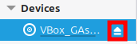

A notification will appear once media is safely ejected. Once the initial popup disappears on its own, it can be accessed from the Notifications icon on the taskbar: 
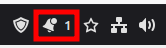

On the topic of notifications, there should be a pending system report. Open it from the System Reports icon on the taskbar: 
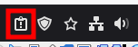

The pending report should be a reminder to enable system snapshots. Linux Mint uses a tool called Timeshift for its system snapshots. This is the official description of the tool from the Linux Mint team:
> Timeshift for Linux is an application that provides functionality similar to the System Restore feature in Windows and the Time Machine tool in Mac OS. Timeshift protects your system by taking incremental snapshots of the file system at regular intervals. These snapshots can be restored at a later date to undo all changes to the system.

The snapshots include files such as system configuration files and installed applications. What isn't included is user data, such as home directories under `/home`, so this isn't a backup solution. Configuring it is out-of-scope, so just close System Information.

## File Manager

Nemo is Cinnamon's file manager, similar to Windows Explorer or macOS Finder. It's based on GNOME's file manager, GNOME Files, formerly known as Nautilus. Other than supporting multiple tabs per window, it's pretty similar to versions of Windows Explorer since Windows Vista.

### Keyboard Shortcuts

* Open properties of selected file or folder: `[Alt]`+`[Enter]`
* Toggle sidebar: `[F9]`
* The shortcuts for tabs are similar to most web browsers:
  * New tab: `[Ctrl]`+`[T]`.
  * Switch to right tab: `[Ctrl]`+`[PageDown]`.
  * Switch to left tab: `[Ctrl]`+`[PageUp]`.
  * Switch to specific tab: `[Alt>]`+`[0-9]`
    * `[Alt]`+`[1]`: 1st tab.
    * `[Alt]`+`[9]`: 9th tab.
    * `[Alt]`+`[0]`: 10th tab.
  * Close tab: `[Ctrl]`+`[W]`
* View keyboard shortcuts: `[Ctrl]`+`[F1]` 
  This can be searched with the magnifying glass in the top-left corner or `[Ctrl]`+`[F]`.
* To type something in the address bar, press `[/]` or `[~]`. Try entering `/home`. This also applies to the file picker when opening a file in an app. 
  We can also just click on the address bar to access the text path. Unfortunately, this doesn't apply to the file picker.

### Favourites and Bookmarks

Go to the directory that the shared folder is in, which would be File System according to the pre-workshop instructions. If you're frequently moving files between the host and guest, you'll want the shared folder to be convenient to navigate to. Cinnamon and Nemo offer 2 features for this: Favorites and Bookmarks.

To add the shared folder to bookmarks, drag it over the sidebar. The Bookmarks category will appear. Release it once a line appears under Bookmarks.

To add it to Favorites, right-click on it and choose "Add to favorites". Favourited items will be hoisted at the top of directory listings. There are 2 ways of accessing Favorites: From the sidebar and from the taskbar: 
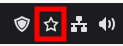

### Shortcuts

Shortcuts to files and folders can be created on the filesystem, similar to Windows shortcuts. A common way to do this is by creating symbolic links, or "symlinks" for short, to them. Navigate to the shared folder and press the "Go to parent folder" button or `[Backspace]`, `[Alt]`+`[Left]` or `[Alt]`+`[Up]`: 
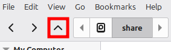

The shared folder itself should now be selected. While holding `[Ctrl]`+`[Shift]`, drag it onto the desktop. It'll now show up as symlink.

> # Hard Links
> 
> Hard links are another type of filesystem link on Linux. Instead of pointing to a file path, they point directly to the filesystem object, or inode as they're called. They are indistinguishable from the original inode, and work even when the original is deleted. Creating and managing hard links required root access.
> 
> Windows also has symlinks and hard links. Interestingly, on Windows, symlinks are the ones that require admin access to create, not hard links.
> 
> We won't be covering the creation of hard links in this workshop.

While Linux desktop environments have a `.desktop` file for desktop entries that are more comparable to Windows' `.lnk` shortcut files, these are out-of-scope. If you'd like to learn about them, the Arch Linux wiki has a good article for them: <https://wiki.archlinux.org/title/Desktop_entries>

## Desktop Environment

A desktop environment, or DE for short, is an implementation of the GUI desktop interface of a system. They may also come with apps that are built for them, such as a basic text editor. The 2 most popular desktop environments are GNOME and KDE.

As the name implies, Linux Mint Cinnamon Edition uses the Cinnamon DE, which is made by the Linux Mint team and based on GNOME.

### Windows Comparison

Cinnamon should feel very familiar to Windows users. It has:
* A docking-style taskbar with a start menu and system tray for background apps.
  * In Cinnamon, the taskbar is called the panel and the start menu is called the main menu.
* Window controls in the top-right corners of windows.
* Similar keyboard shortcuts for navigation. `[Win]` opens the start menu, or main menu, and `[Alt]`+`[Tab]` switches windows.
  * The Linux community prefers to call `[Win]` the "super key" or "OS key" as a more OS-agnostic name.
  * Key-code-wise, the Mac equivalent of the super key is `[Command]`.
* Virtual desktops. On Cinnamon, they're called workspaces.

Here are some cases where Cinnamon and Windows shortcuts differ:
* Virtual Desktops/Workspaces
  * For Windows virtual desktops:
    * They are opened with `[Ctrl]`+`[Win]`+`[D]`.
    * They are switched using `[Ctrl]`+`[Win]` with `[Left]` and `[Right]`.
    * Their overview is opened with `[Win]`+`[Tab]` or the Task View button in the taskbar.
  * For Cinnamon workspaces:
    * There are no official keyboard shortcuts for opening new workspaces. 
      However, the script `new_workspace.sh` and a custom keyboard shortcut can solve this.
    * They are switched using `[Ctrl]`+`[Alt]` with `[Left]` and `[Right]`.
    * Their overview is opened with `[Ctrl]`+`[Alt]`+`[Up]`. There are 4 workspaces open by default and they can be closed or opened here.
* Window Switching - While Windows and Cinnamon both use `[Alt]`+`[Tab]` for window switching, Cinnamon moves minimised windows to the end of the `[Alt]`+`[Tab]` switcher by default. This can be disabled in System Settings.

### Configuration

Right-clicking on the Desktop gives us the option to change the desktop background and display settings. Linux Mint comes with a lot of interesting desktop backgrounds to choose from. Of course, an image in a folder can be set as a custom background. The Pictures sections represents the Pictures folder. Other folders can be added by pressing the plus button in the bottom-right corner of the window: 
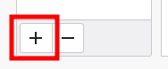

Let's set `sample_background.png` as the desktop background.

Let's explore the system settings. Open the main menu, scroll to the bottom of the left side of it and select System Settings: 
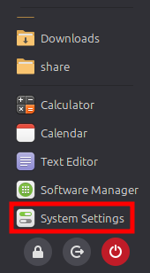

There are lots of configuration panels to choose from, but let's just focus on Night Light, Startup Applications and Keyboard:
* Night Light: Like in most OSes, gives the screen a warmer tint towards the end of the day to reduce the amount of blue light exposed to our eyes, improving the quality of our sleep. Enabling it is recommended. We can also adjust the colour temperature it uses and the schedule for when it's active.
* Startup Applications: Configures what applications run on login.
* Windows: Configures windows on Cinnamon.
  * Under Alt-Tab, "Move minimized windows to the end of the alt-tab switcher" can be disabled.
  * Windows can be dragged from any point instead of only the top bar while holding `[Alt]`. Under Behavior, this key can be changed to `[Super]`, `[Ctrl]` or disabled. I recommend `[Super]`.
* Keyboard (under Hardware): Configures how the system responds to keystrokes. This is where keyboard shortcuts are configured.

Let's configure some custom keyboard shortcuts under the Shortcuts tab:
* Under the Windows category, select "Maximize window" and select one of the unassigned bindings. Try setting `[Shift]`+`[Super]`+`[Up]` as a binding. It will inform us when a key combination is already in use. `[Ctrl]`+`[Super]`+`[Up]` should be available. 
  You may be interested in choosing key combinations for "Minimize window" and "Unmaximize window". I suggest `[Super]`+`[PageDown]` or `[Ctrl]`+`[Super]`+`[PageDown]` and `[Ctrl]`+`[Super]`+`[Down]` respectively.
* We can even create custom shortcuts to run specific applications with specific arguments. For example, press "Add custom shortcut" at the bottom. In the Name field, enter a name like "Launch system monitor", and in the Command field, enter `gnome-system-monitor`. This allows us to open System Monitor using the same shortcut for opening Windows Task Manger, which is `[Ctrl]`+`[Shift]`+`[Escape]`.

## Bundled Software

Linux Mint, like most OSes, come with bundled apps for basic tasks. They can all be found in the main menu, under All Applications or their respective categories. We will be covering some essential ones. Beware that a lot of third party apps bundled with Mint are old, custom versions of them and aren't representative of the versions available on other distros.

### Xed - Text Editor

Xed is Linux Mint's text editor. Let's view `new_workspace.sh` in it. Right-click on the file and, under Open With, select Text Editor.

Xed has the following features:
* Tabs for opening multiple documents in the same window.
* A dropdown menu for choosing the filetype for syntax highlighting purposes. 
  Try changing the language to CSS, you can search for it. Select CSS and double-click it or press `[Enter]`. The syntax highlighting should change.
* A dropdown menu for choosing the tab character size and whether to use spaces instead of tabs. 
  Try changing the tab sizes and watch them change in the file.
* A side pane for viewing open files and navigating the file system. Useful for dealing with a folder full of files for the same project. The "Go to parent folder" is also present here.

Here are some keyboard shortcuts in Xed:
* `[Ctrl]`+`[N]` opens a new document in a tab.
* `[Ctrl]`+`[Tab]` switches to the tab on the right. 
  `[Ctrl]`+`[Shift]`+`[Tab]` switches to the one on the left.
* `[Alt]`+`[0-9]` switches to a specific tab, same as Nemo.
* `[F5]` inserts the current date. 
  This is also true for Notepad on Windows, although without the option to choose a format.

### Celluloid

Celluloid is a media player for video and audio. It is a frontend for mpv, a more command-line oriented media player. Let's try it out with `sample_video.mkv` in the shared folder.

In the top-left corner, there's a plus-shaped button for opening media and opening a new Celluloid window. In the top-right corner, there's the fullscreen button and a hamburger menu containing various options:
* Visibility of playback controls.
* Playlist options. If you want to use playlist files, use M3U files as they are the only playlist file format supported by it. M3U files are also supported by VLC Media Player, allowing for cross compatibility.
* Media track options. If a media file contains multiple video, audio or subtitle tracks, they can be chosen here.
* Celluloid preferences. The last 4 options in the Interface tab might be of interest to you. The other tabs are for configuring mpv itself.
* Information about keyboard shortcuts. 
  This is similar to the one in Nemo.
* Information about Celluloid.

Let's explore the basic keyboard shortcuts of Celluloid:
* Just like most players, `[Space]` pauses and unpauses the video. 
  `[P]` can also be used to do the same.
* `[Left]` and `[Right]` arrow keys seek by 5-10 seconds (it's a little buggy so the amount skipped is inconsistent. Might be fixed in new versions of Celluloid). 
  Holding `[Shift]` changes this to 1 second.
* Up and down arrow keys seek by a minute. 
  Holding `[Shift]` changes this to 5 seconds. It seems to actually be 5 seconds unlike the `[Left]` and `[Right]` arrow keys.
* `[O]` shows the video progress in the top-left corner for about a second. 
  Holding `[Shift]` makes it persist until `[Shift]`+`[I]` is pressed again.
* `[I]` shows playback information at the moment it was pressed.
  * This information contains information about the current video and audio track such as codecs, framerate, resolution, audio channel count, audio sample rate and bit rate.
  * Holding `[Shift]` makes it update every second until `[Shift]`+`[O]` is pressed again.
* `[V]` toggles subtitle visibility.
* `[J]` switches to the next subtitle option. 
  Holding `[Shift]` makes it switch to the previous one.

### Document Viewer - Xreader

Xreader is Linux Mint's document viewer. It can be used to view PDF files, and is the default app for them. Open `Pre-Workshop.pdf` in the shared folder.

By default, the zoom level is hidden. This can be changed under Preferences, which can be accessed under Edit in the menu bar or `[Ctrl]`+`[Shift]`+`[P]`. Enable "Show zoom selector" and close the window. We can now see, select and enter specific zoom levels. We can also press this button to view the document at it's original size: 
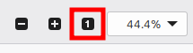

Right now, we can only scroll 1 page at a time. We can solve this by selecting Reader View: 
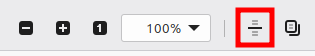

### System Monitor - GNOME System Monitor

GNOME System Monitor is Linux Mint's equivalent to Windows Task Manger. There are 3 tabs:
* Processes - Equivalent to the Details tab in Task Manager.
* Resources - Similar to the Performance tab in Task Manager, although not as detailed.
* File Systems - Information about connected disks/file systems.

Configuration options can be found in the the hamburger menu: 

In the hamburger menu, we can choose to show all processes instead of just the ones owned by our user by selecting "All Processes". Let's open Preferences:
* Under the Processes tab, we can reduce the update interval for more frequent process information updates. Let's change it to 1 second. 
  We can also toggle what columns are shown in the Processes tab. For example, try disabling the "Disk read total" and "Disk write total" columns.
* Under the Resources tab, we can change the resolution of the graphs and also toggle graph smoothing. Also try enabling "Draw CPU Chart as Stacked Area Chart".

### Calendar - GNOME Calendar

GNOME Calendar, Linux Mint's Calendar app, can be accessed either from the main menu or from pressing the time in the bottom-right corner of the screen and pressing "No Events".

It's Date and Time Settings can be accessed via the hamburger menu in the top-right corner of the sidebar. It can also be accessed via the panel clock: 
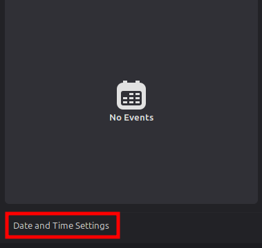

The Date and Time Settings can be used to set:
* The time zone.
* The time. 
  Network time syncing can be toggled here. It's disabled by default, so be sure to enable it.
* The date and time format. The following can be toggled:
  * 24-hour time format.
  * Date displayed next to time.
  * Seconds displayed in time (may or may not impact battery life).
* The first day of the week in the calendar.
  * Either Monday, Sunday or whatever matches your system locale.
  * Doesn't seem to affect the Calendar app itself.

To schedule an event in the Calendar app, left-click a day. A popup will appear for scheduling an event. We can set a name, choose a category (Personal is the only one available out of the box) and either add it immediately or choose "Edit Details...". By default, events are all-day and non-repeating. In the details popup, we can:
* Set a location.
* Specify start and end dates and times.
* Choose a repeat frequency.
  * We can specify when to stop repeating the event, either after a number of occurrences or a specific date.
* Set reminders in advance. Multiple reminders can be set and an alarm sound can be toggled for each one.
* Add a note. This is only visible when viewing the event in the Calendar app.

Of course, press "Save" in the top-right corner of the pop-up to add the event. Once an event is added, notifications will be sent when they start or their reminders trigger.

Events can be viewed from the calendar popup from the panel clock. Dates with events on them have a blue dot underneath them. Selecting them lists the events on those dates on the left. Selecting them there opens them in the Calendar app, showing the note attached to it if one was set.

Events can be edited with the "Edit..." button. At the bottom of the editing popup is the option to delete the event.

### Other

* **Image Viewer - Xviewer** 
  Linux Mint's image viewer. Not much to say other than that image properties can be accessed under File in the menu bar or `[Alt]`+`[Enter]`. Try it with `swinux_background.png`.
* **GNOME Rhythmbox** 
  A playlist-focused music player. Unlike Celluloid, it only plays audio.
* **Mozilla Firefox** 
  An open-source non-Chromium-based web browser.
* **Onboard** 
  An on-screen keyboard app. Not to be confused with Cinnamon's keyboard, which is part of the DE itself.
* **GNOME Calculator** 
  A simple calculator, similar to that on Windows or macOS.
  * More advanced modes can be selected from the dropdown menu at the top.
  * More options can be found in the hamburger menu.
* **Disks - GNOME Disk Utility** 
  A tool for creating and formatting disk partitions and partitions tables, just like Windows' Disk Management utility. 
  You may also compare it to GParted if you're familiar with it from Linux-based rescue environments such as Rescuezilla.
* **GNOME Disk Usage Analyser (formerly Baobab)** 
  Analyses which files and folders are using up the most disk space, similar to WinDirStat or the more modern WizTree. 
  Try it with your home folder. Analysing the whole disk is not recommended as it will take a while to complete, especially in a VM.
* **GNOME Document Scanner (formerly Simple Scan)** 
  A program for accessing scanners, similar to NAPS2, an open-source scanning program available for Windows.
* **LibreOffice** 
  A free and open source alternative to the Microsoft Office suite.

* **Notes - Sticky** 
  A program for leaving notes across the screen, similar to Sitcky Notes on Windows. 
  To configure them to appear on login, open Preferences in the hamburger menu and enable "Start automatically" and "Show notes on screen" under "Automatic start".
* **Mintstick** 
  A program for formatting external media, usually thumb drives. This is presented as 2 programs:
  * USB Stick Formatter: For formatting external media. Similar to the Windows Format utility.
  * USB Image Writer: For imaging bootable disk images (`.iso`, `.img`, etc.) to external media. Similar to Rufus and Balena Etcher.
* **GNOME Terminal** 
  A terminal for running shell commands, like Windows Command Prompt or macOS Terminal.

## Installing Software

We'll now install software on Linux Mint. As mentioned earlier, software is typically installed on Linux via package managers. While many imagine installing them through the command-line, it's possible to do so through a polished GUI frontend.

Software Manager is Linux Mint's GUI frontend for package managers. It's similar to the Microsoft Store on Windows or App Store on macOS. Let's try installing an app from it. Open it and search for "clocks" once it's done loading.

GNOME Clocks is a clock app, similar to the Clock app in Windows. Select the "Clocks" FlatHub result and press "Install": 
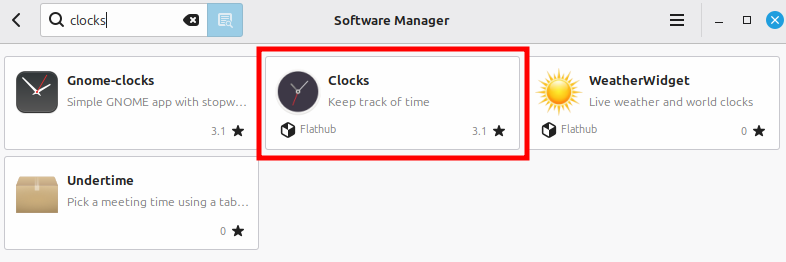

It will ask to download the packages it depends on. Press "Continue" to install them. Installation may take a while. Once it's installed, it can be Launched from Software Manager or the main menu. You may also notice that there's a system package option for this app.

### Flatpak

Linux Mint comes with 2 types of packages: System packages and Flatpaks packages, colloquially known as "flatpaks". While system packages simply represent collections of files, usually for system components and apps, Flatpak applications are sandboxed and have a permission system similar to Android and iOS. Flatpak permissions can be adjusted via an app called Flatseal, which can also be installed using Software Manager, although this is out of scope.

Because Flatpak works separately from traditional package managers, it can be used on any Linux distro, making it a great platform for publishing apps in a distro-agnostic way. This is also great if the native package for an app on a specific distro is problematic. Many Linux Mint packages, such as GNOME Clocks, are pretty old and therefore lack the latest features. On the other hand, the Flatpak package is usually up to date. As the time of writing, the system package contains version 46.0, while the Flatpak package contains version 51.0.

### Other Apps

You may want to explore/install some of these other apps:
* **VLC Media Player** - As a fallback for videos that don't play properly in Celluloid. 
  The Flatpak package is recommended due to the system package not supporting VAAPI, which is needed for hardware-acceleration on Intel and AMD graphics.
* **Steam** - Steam comes with **Steam Proton**, allowing us to run Windows games on Linux. It's based on **WINE**.
* **Notepad Next** - "A cross-platform, reimplementation of Notepad++"
* **VSCodium** - An open-source fork of VSCode that strips away Microsoft's invasive telemetry. 
  Also available on Windows.
* **Kate** - A lighter-weight alternative to VSCode/VSCodium.
* **KolourPaint** - A basic image editor, similar to Microsoft Paint.
* **Krita** - A more advanced image editor, similarly as capable as Paint.NET.
* **Kdenlive** - A basic video editor. Also available on Windows.

## Bonus

Let's configure a keyboard shortcut for opening a new workspace.
1. Copy `new_workspace.sh` to the clipboard.
2. Type `~/.local` to navigate to it.
3. Create and enter a directory called `bin`. 
   This is where user-specific executables would go where they would be in our system path.
4. Paste the copied file.
5. Open the file's properties and ensure it's executable under Permissions.
6. Add a custom keyboard shortcut that runs `/home/<user>/.local/bin/new_workspace.sh` and bind it to something like `[Ctrl]`+`[Alt]`+`[D]`. 
  A name like "Open new workspace" is recommended.
7. Test the new shortcut.

## Theory

This is the end of the practical tasks for this Workshop. Take a moment to reflect on how much we were able to do without touching the command-line.

We'll spend the rest of the workshop discussing the theory of installing Linux on a daily driver.

### OS Co-Existence

If you don't want to give up Windows entirely, in case you need it for stuff that doesn't work on Linux, you can run it in a Virtual Machine, just like in the workshop.

You can also install it alongside your current OS, which is called dual-booting or multi-booting if you install more than 2 OSes.

You can install Linux on the same drive as Windows, but it's more complex and potentially riskier as Windows updates can break the bootloader used for Linux, although this is less likely to happen when chaining the Windows bootloader as an option in the bootloader used for Linux.

Separate drives for each OS can be done on some laptops:
* Some high-end laptops have 2 M.2 slots, allowing for the installation of 2 separate M.2 SSDs.
* Older laptops may have an optical drive. This can be switched out for an adaptor that allows a 2.5" SATA drive to be installed in its place: 
  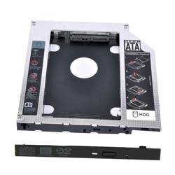
  <!-- https://www.amazon.in/dp/B081Z5STG6 -->

* Some laptop models have a configuration option for a HDD or SSD. If the SSD option uses an M.2 SSD, there's a good chance there's a slot and header for a 2.5" SATA drive as well. 
  For example, the Lenovo IdeaPad 3 15ADA05 comes with an M.2 SSD and said space for a SATA drive. All that's needed is a ~$20 kit from eBay containing the mounting bracket, cable and screws in order to install a second SSD: 
  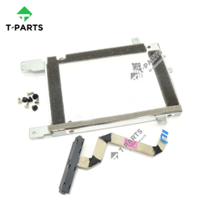
  <!-- https://www.ebay.com.au/itm/124514221210 -->

### Hardware Considerations

Since most PC hardware wasn't designed for Linux, more consideration about hardware choices should be made:
* Nvidia GPUs are not recommended due to their historically proprietary nature (even then their drivers are still not fully open source) and stability issues. For this reason, AMD GPUs are usually recommended.
* Some Wi-Fi and Bluetooth radios may not have Linux drivers.
* As RGB lighting is usually managed by various proprietary software, it is likely that it can't be managed properly on Linux.

## Homework

As a homework activity, try:
* Exploring the rest of the Welcome screen. It can be accessed from the main menu like any other app.
* Checking out some of the other apps mentioned that could be installed from Software Manager.
* Exploring another distro in another VM. I suggest:
  1. KDE Neon
  2. Ubuntu Desktop
  3. Fedora Linux

<!--I recommend you hold on to your virtual machines, as you will be need access to a Linux system for the next workshop: Introduction to the Linux CLI.-->

## References

* `sample_video.mkv`: <https://youtu.be/mzAfich6mow>
* <a id="ref-1-src" href="#ref-1-use">\[1]</a>: Dennis M. Ritchie (1984). "The Evolution of the Unix Time-sharing System". *Communications of the ACM*.
* \[2] [a](#ref-2-use-a) [b](#ref-2-use-b): <https://web.mit.edu/multics-history/>
  > It was a joint project with M.I.T., General Electric, and Bell Labs.
* <a id="ref-3-src" href="#ref-3-use">\[3]</a>: <https://www.nokia.com/bell-labs/about/dennis-m-ritchie/hist.pdf>
  > The main reason for this was the slow, though clearly inevitable, withdrawal of the Labs from the Multics project.
* <a id="ref-4-src" href="#ref-4-use">\[4]</a>: <http://cse.unl.edu/~witty/class/csce351/howto/ken_thompson.pdf>
  > This huge virtual memory space was the unifying concept behind Multics - and it had to be tried in an era when everyone was looking for the grand unification theory of programming - but I thought it was a big mistake.
* <a id="ref-5-src" href="#ref-5-use">\[5]</a>: <https://www.linuxjournal.com/article/7035>
  > Multics was an acronym for something like Multiplexed Information and Computing Service, and it was big and complicated because it had many of everything. I suggested Unics for Ken's new system, because it was small and had at most one of anything. (Multi and uni are both Latin roots, so it was a very weak pun.) Someone else spelled it with the letter X; no one can remember who.
* <a id="ref-5-src" href="#ref-6-use">\[6]</a>: <https://www.youtube.com/watch?v=qaDpjlFpbfo>
* <a id="ref-5-src" href="#ref-7-use">\[7]</a>: <https://web.archive.org/web/20121003060514/http://www.dina.dk/~abraham/Linus_vs_Tanenbaum.html>
* <a id="ref-5-src" href="#ref-8-use">\[8]</a>: <http://gondwanaland.com/meta/history/interview.html>